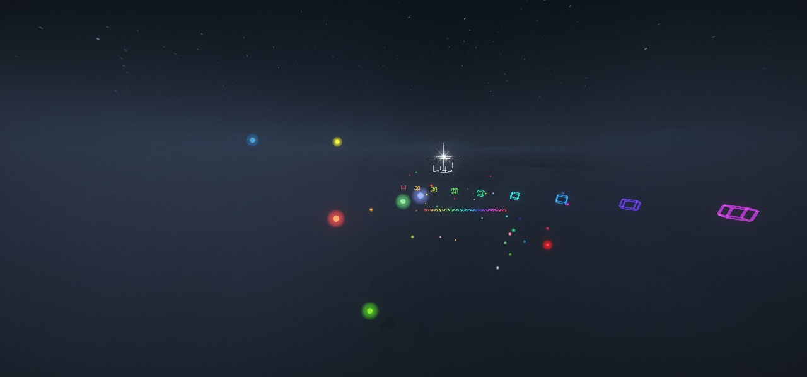
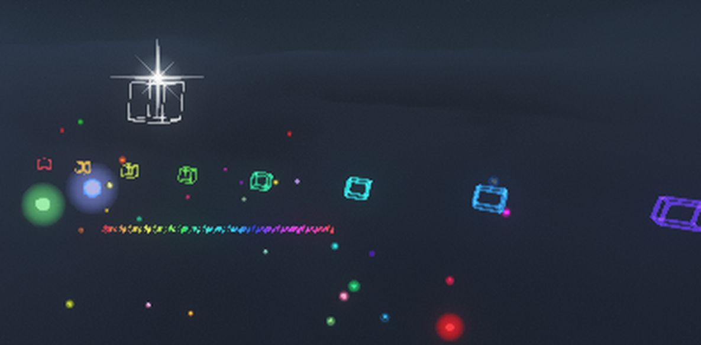

# 长虹陨落之歌 · Arcfall Ballad Longbow

**中文** | [English](README_EN.md)

一个 Minecraft **26.1 Fabric** 模组：把 B 站里那把「长虹陨落之歌」做成能真正拿在手里射的弓——
蓄能超载、白框锁敌、必中追踪、按弹道方向犁出一条圆柱形废墟，
外加一整套客户端特效：45 秒不散的彩虹小方框尾迹、挂在箭头上的四芒星、尾迹旁浮着的彩色光球。



> **这是非官方粉丝作品。** 设计原型来自 B 站 UP 主 [SandWalls](https://space.bilibili.com/3546643544673052)
> 的视频系列「大肥鱼做模组」，本项目与其无隶属关系，也不是官方实现。
> 具体出处见 [来源与致谢](#来源与致谢)。

## 它有什么

**弓本身**

- 蓄能时间轴：0.5 秒内是「轻击档」（只杀怪、不动地形）→ 2 秒充满 10000 → 2~10 秒平台期（HUD 倒计时）→ 10~16 秒超载冲到 500000
- 蓄能条按「10000 在正中间」设计，左半段 0→10000，右半段 10000→500000
- 白框锁敌：准星指到的实体套一个白框（客户端 64 格射线），左键锁定后换粗白框并通告服务端（上限 128 格）
- 必中追踪：锁定后开火，箭每 tick 以 0.45 的强度把速度掰向目标，非生物实体（末地水晶等）也能锁
- 破坏：命中瞬间沿**弹道方向**炸出一个圆柱，半径 2→32、长度 8→128（满蓄 4×4×8 区块），分帧每 tick 6000 方块
- 穿透：命中实体后按蓄能拿到 0.48~24 格的穿透预算，预算按实际位移扣，扣完销毁
- 零散布、无空气阻力（水里除外的物理都会照常生效）
- 命中末影人改用 `playerAttack` 伤害源，绕开原版「弹射物命中就传送 64 次」的保护

**顺手加的**

- 持弓自动获得「幻」（无限期 `mayfly`，生存模式原地起飞）和「水火不侵」（抗火 / 水下呼吸 / 水下速掘）
- 主手持弓时挖掘速度强制 ≥160 且必定正确掉落（石头 1 tick、黑曜石约 0.5 秒；基岩之类的不可破坏方块仍然无效）
- 自动附上力量 V / 冲击 II / 火焰 I / 无限 I / 耐久 III / 经验修补 I
- 世界启动时强制 `keepInventory`
- 「虹」+ G 键三档疾行（0.5 / 1.2 格每 tick）、H 键探矿模式（跳过矿物只清围岩）
- 物品名逐字渲染成彩虹渐变

**视觉**

| 特效 | 做法 | 寿命 |
|---|---|---|
| 彩虹尾迹 | 每 0.15 格一个空心小线框方块（12 条发光棱），颜色沿弹道推进 | 45 秒 |
| 箭头星芒 | 纯几何四芒星：4 长刺 + 4 斜刺 + 两层圆晕，世界尺寸随距离补偿，屏幕上大小恒定 | 跟箭 |
| 尾迹光球 | 自定义粒子 `longbow:trail_orb`：半透光小光球，撒在轨迹周围 0.7~3.8 格的一圈里，带呼吸和缓慢上浮 | 15 秒 |
| 锁定白框 | 3D 线框，同样走高亮面片批次 | 跟手 |



上面这四条特效全部在**开了光影（Iris + Complementary）**的情况下验证过——这中间踩的坑都写在
[docs/实现原理.md](docs/实现原理.md) 里，想给 Minecraft 26.1 做发光特效的话大概能省几天。

## 环境

| 项 | 版本 |
|---|---|
| Minecraft | 26.1 / 26.1.2 |
| Fabric Loader | 0.19.3 |
| Fabric API | 0.155.2+26.1.2 |
| JDK | 25 |
| Gradle | 9.7.1（仓库带 wrapper） |
| 映射 | Mojang 官方映射（26.1 没有 Yarn） |

## 安装

1. 装好 Fabric Loader 0.19.3 + Fabric API
2. 把 `longbow-1.0.0.jar` 丢进 `.minecraft/mods/`
3. 启动游戏

单人 / 局域网都能直接用。**多人服务器需要服务端和客户端都装**——`longbow:fx`、`longbow:lock`、
`longbow:dash`、`longbow:prospect` 都是自定义网络包，只装一边会不同步。

## 合成

1. 工作台按 `ROY / GCB / PKW` 摆满红橙黄绿青蓝紫黑白九种染料 → **「虹」**
2. 「虹」+ 原版弓 → **长虹陨落之歌**
3. 创造模式物品栏的「战斗」分类里也能直接取

## 操作

| 键 | 作用 |
|---|---|
| 左键 | 锁定准星指向的实体 |
| G | 「虹」疾行档位循环：关 → 一档（马速）→ 二档（鞘翅速） |
| H | 探矿模式开关 |

## 构建

```bash
./gradlew build           # Windows: gradlew.bat build
# 产物 build/libs/longbow-1.0.0.jar
```

首次构建要联网下 Minecraft 26.1 和 Fabric API。Linux/macOS 上把 `JAVA_HOME` 指到 JDK 25 就行。

## 自测

游戏内执行：

```
/longbow selftest
```

34 项断言覆盖：注册、蓄能曲线、破坏尺寸、分帧破坏、追踪收敛、穿透预算、击杀归属、探矿、状态效果、
末影人特判等等。结果同时写进聊天栏和服务端日志，正常应该 `34/34 passed`。

仓库里还留了一套无人值守真机测试的钩子（`-Dlongbow.autotest=1` + `--quickPlaySingleplayer`）：
自动跑自测、摆出排障用的特效样品、在固定 tick 截图、然后退出。CI 里跑不了 MC 客户端，
但这套钩子让"改一版 → 跑一次 → 看截图"这件事从十几分钟压到了一分钟。

## 它是怎么做的

三句话版本：机制在服务端用 mixin 改箭的物理和命中，特效在客户端用自建渲染批次画几何，
两者之间只传一种「特效点」包（拖尾点 / 箭头位置标记），不传任何实体引用。

想细看的话：

- [docs/实现原理.md](docs/实现原理.md) —— 渲染管线怎么绕开光影、几何特效怎么拼、粒子三件套、网络包设计、全部调参速查表
- [docs/兼容性与局限.md](docs/兼容性与局限.md) —— 光影 / 多人 / 性能的边界，已知缺陷，以及没做的东西

## 已知局限（摘要）

- 客户端特效是**纯客户端**的：只有在 `longbow:fx` 192 格广播范围内的玩家看得到
- 破坏是"逐方块挖掉"，不是爆炸实体，所以没有掉落物、没有爆炸音效
- 满蓄一次扫描 4×4×8 区块的方块，对低配机器有压力（分帧 6000/tick 是为此加的）
- 尾迹在极近距离会连成一片，看得出是一串框而不是一段光带
- 只在单人 + Iris 光影下验证过，多人服务器、其他光影包、其他 MC 版本都没测

## 来源与致谢

- **设计原型**：B 站 UP 主 [SandWalls](https://space.bilibili.com/3546643544673052) 的视频
  「[使用近两亿Token再次鞭策大肥鱼制作的MC模组有多逆天？？](https://www.bilibili.com/video/BV1vbpd6gEPi)」
  （BV1vbpd6gEPi，2026-10-12 发布，属于合集「大肥鱼做模组」）。
  本项目是照着里面演示的效果做的二次实现，**不是**该 UP 主的官方版本。
- 「幻」「水火不侵」这两个状态名是本项目自己起的，功能对应视频里演示的持弓增益；
  视频里出现过的「神秘控制面板」「时停模块」本项目**没有做**（见 [docs/兼容性与局限.md](docs/兼容性与局限.md)）。
- 物品贴图是在**原版弓贴图**上逐像素改色得到的，版权属于 Mojang Studios / Microsoft。
- 构建离不开 [Fabric](https://fabricmc.net/) 这套工具链。

## 许可证

代码按 [MIT](LICENSE) 授权。上面提到的 Minecraft 素材、视频设计原型不在这个授权范围内。
