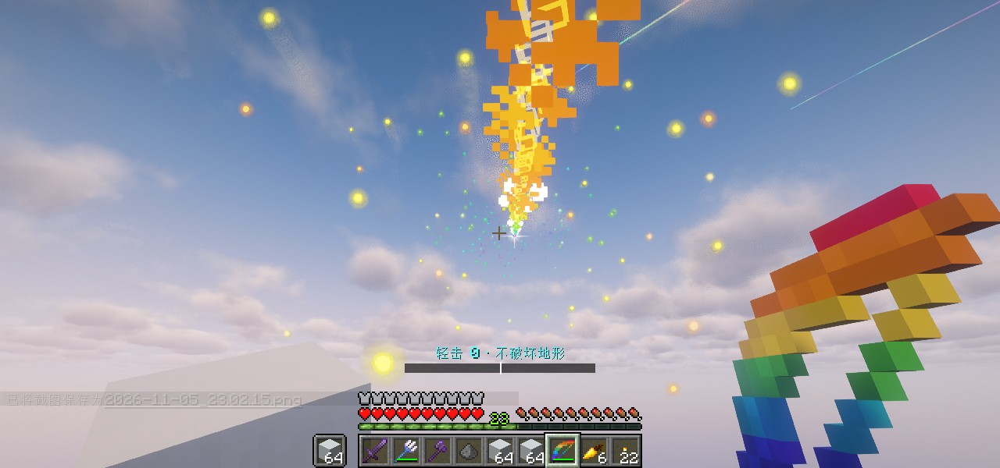
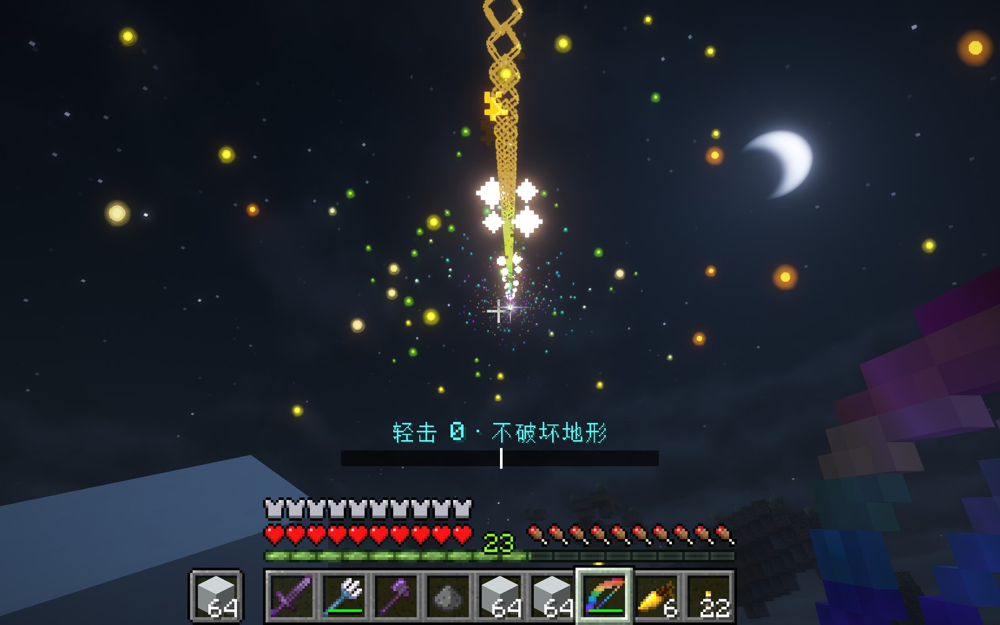

# Arcfall Ballad Longbow

[中文](README.md) | **English**

A Minecraft **26.1 Fabric** mod that turns the bow from a Chinese Bilibili video into something you can
actually draw and shoot: charge-to-overload, white-box target locking, homing arrows, and a cylindrical
crater carved along the arrow's flight path — plus a full client-side VFX layer: a 45-second rainbow
wireframe trail, a four-pointed star riding on the arrow, and coloured orbs drifting around the trail.

<p align="center">
  
  
</p>

> **Unofficial fan project.** The design originates from the video series "大肥鱼做模组" by the Chinese
> creator [SandWalls](https://space.bilibili.com/3546643544673052). This project is not affiliated with
> them and is not an official implementation. Full citation is in [Credits](#credits).

## What's in it

**The bow**

- Charge timeline: under 0.5 s you get the "light shot" tier (kills mobs, leaves terrain intact) → 10 000 at 2 s → a plateau from 2 s to 10 s (with a HUD countdown) → overload ramps to 500 000 from 10 s to 16 s
- The charge bar is laid out with 10 000 dead centre: left half 0 → 10 000, right half 10 000 → 500 000
- Target locking: whatever the crosshair hits gets a white box (client-side 64-block raycast). Left click locks it, swaps to a thicker box, and notifies the server (128-block cap)
- Homing: once locked, the arrow bends its velocity toward the target by 0.45 each tick. Non-living entities (end crystals, etc.) can be locked too
- Destruction: on impact, a cylinder is carved along the **flight direction** — radius 2 → 32, length 8 → 128 blocks (4×4×8 chunks at full charge), executed in frames at 6 000 blocks per tick
- Damage to mobs: a direct hit uses vanilla arrow damage (the bow auto-enchants Power V and friends); on impact every living thing **inside the cylinder is flat-out killed with `hurtServer(1e9)`** — invulnerability frames are zeroed first, so there is no damage-immunity window — with a radius of max(3, blast radius): 3 blocks on the light tier, 32 at full charge
- Kill credit: the kill uses a damage source carrying the shooter (`source(DamageTypes.MAGIC, player)`), so **mobs killed by the blast rather than the arrow still drop XP and count as your kills**; the shooter themself is excluded from the kill list
- Pierce: hitting an entity grants a 0.48–24 block pierce budget based on charge; the budget is spent by actual distance travelled and the arrow despawns when it runs out
- Zero spread, no air drag (water and other vanilla physics still apply)
- Hitting an Enderman uses a `playerAttack` damage source, sidestepping vanilla's "projectile hit → teleport 64 times" protection

**Quality of life**

- Holding the bow grants "幻" (Phantom: infinite `mayfly`, so you can take off in survival) and "水火不侵" (Fire and Water Immunity: fire resistance, water breathing, underwater haste)
- Main-hand holding the bow forces dig speed ≥ 160 with guaranteed correct drops (stone in 1 tick, obsidian ~0.5 s; indestructible blocks like bedrock still won't break)
- Auto-enchants: Power V, Punch II, Flame I, Infinity I, Unbreaking III, Mending I
- Forces `keepInventory` on world start
- "虹" (Rainbow) item plus G for three dash gears (0.5 / 1.2 blocks per tick), H for mining mode (skips ores, clears only the host rock)
- Item names rendered as per-character rainbow gradients

**Visuals**

| Effect | Technique | Lifetime |
|---|---|---|
| Rainbow trail | One hollow wireframe cube every 0.15 blocks (12 glowing edges), colour advancing along the path | 45 s |
| Arrow star | Pure geometry: a four-pointed star with 4 long spikes, 4 diagonal spikes and two halo rings, world size compensated by distance so it stays a constant size on screen | follows the arrow |
| Trail orbs | Custom particle `longbow:trail_orb`: translucent little light orbs scattered in a 0.7–3.8 block shell around the path, with breathing and a slow upward drift | 15 s |
| Lock boxes | 3D wireframe, drawn through the same glowing-quad batch | follows the target |

All four effects above were verified **with shaders enabled (Iris + Complementary)**. The pitfalls we hit
along the way are written up in [docs/实现原理.md](docs/实现原理.md) (Chinese) — if you are trying to make
glowing VFX on Minecraft 26.1, that document can probably save you a few days.

## Requirements

| Item | Version |
|---|---|
| Minecraft | 26.1 / 26.1.2 |
| Fabric Loader | 0.19.3 |
| Fabric API | 0.155.2+26.1.2 |
| JDK | 25 |
| Gradle | 9.7.1 (wrapper included) |
| Mappings | Mojang official mappings (26.1 has no Yarn) |

## Installation

1. Install Fabric Loader 0.19.3 and Fabric API
2. Drop `longbow-1.0.0.jar` into `.minecraft/mods/`
3. Launch the game

Single player and LAN work out of the box. **Multiplayer servers need the mod on both sides** —
`longbow:fx`, `longbow:lock`, `longbow:dash` and `longbow:prospect` are custom packets, so installing
only one side will desync.

## Crafting

1. Fill a 3×3 crafting grid with the nine dyes in the order `ROY / GCB / PKW` (red, orange, yellow / green, cyan, blue / purple, black, white) → **"虹"**
2. "虹" + a vanilla bow → **Arcfall Ballad Longbow**
3. Also available directly from the Combat tab in the creative inventory

## Controls

| Key | Action |
|---|---|
| Left click | Lock the entity under the crosshair |
| G | Cycle the "虹" dash gear: off → gear 1 (horse speed) → gear 2 (elytra speed) |
| H | Toggle mining mode |

## Building

```bash
./gradlew build           # Windows: gradlew.bat build
# output: build/libs/longbow-1.0.0.jar
```

The first build needs network access to fetch Minecraft 26.1 and Fabric API. On Linux/macOS just point
`JAVA_HOME` at a JDK 25.

## Self-test

Run in game:

```
/longbow selftest
```

34 assertions cover registration, the charge curve, blast dimensions, framed destruction, homing
convergence, pierce budget, kill credit, mining mode, status effects, the Enderman special case, and more.
Results go to both chat and the server log; a healthy run prints `34/34 passed`.

The repo also keeps an unattended on-device test harness (`-Dlongbow.autotest=1` +
`--quickPlaySingleplayer`): it joins the world, runs the self-test, spawns debug VFX samples, takes
screenshots at fixed ticks and quits. CI can't run a Minecraft client, but this harness cut the
"change a value → run once → look at a screenshot" loop from ~15 minutes down to about one.

## How it works

The three-sentence version: gameplay lives on the server, where mixins rewrite arrow physics and impact
handling; VFX live on the client, drawn through a hand-built render batch; the only thing crossing between
them is a single "effect point" packet (trail points plus an arrow-position flag) — no entity references.

More detail:

- [docs/实现原理.md](docs/实现原理.md) (Chinese) — how the render pipeline dodges shader packs, how the geometry effects are assembled, the particle "three-piece set", packet design, and a full tuning reference table
- [docs/兼容性与局限.md](docs/兼容性与局限.md) (Chinese) — the boundaries of shaders / multiplayer / performance, known defects, and what was never implemented

## Known limitations (summary)

- Client VFX are **client-side only**: only players within the 192-block `longbow:fx` broadcast radius see them
- Destruction is "dig out block by block", not an explosion entity, so there are no drops and no explosion sound
- A full-charge shot scans 4×4×8 chunks of blocks and will tax low-end machines (the 6 000/tick framing exists for this)
- Up close the trail reads as a chain of boxes rather than a continuous light band
- Only verified in single player with Iris shaders; multiplayer, other shader packs and other MC versions are untested
- The blast kill only excludes the shooter: on a server, a teammate standing inside the cylinder **will be killed too**

## Credits

- **Original design**: the Bilibili video
  "[使用近两亿Token再次鞭策大肥鱼制作的MC模组有多逆天？？](https://www.bilibili.com/video/BV1vbpd6gEPi)"
  (BV1vbpd6gEPi, published 2026-10-12, part of the series "大肥鱼做模组") by
  [SandWalls](https://space.bilibili.com/3546643544673052).
  This project is a re-implementation of the effects shown there and is **not** the creator's official version.
- The status names "幻" and "水火不侵" were coined by this project, corresponding to the held-bow buffs
  demonstrated in the video. The video's "神秘控制面板" (entity control panel) and "时停模块" (time-stop module)
  are **not implemented** here — see [docs/兼容性与局限.md](docs/兼容性与局限.md).
- Item textures are derived from the **vanilla bow texture** by per-pixel recolouring; copyright belongs to
  Mojang Studios / Microsoft.
- Built with the [Fabric](https://fabricmc.net/) toolchain.

## License

Code is released under the [MIT license](LICENSE). The Minecraft assets and the original video design
mentioned above are not covered by that license.
