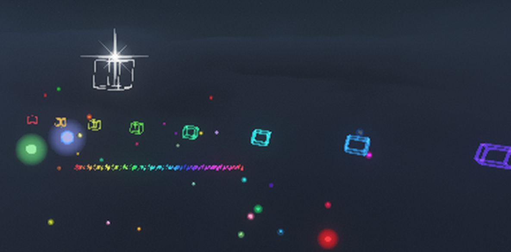
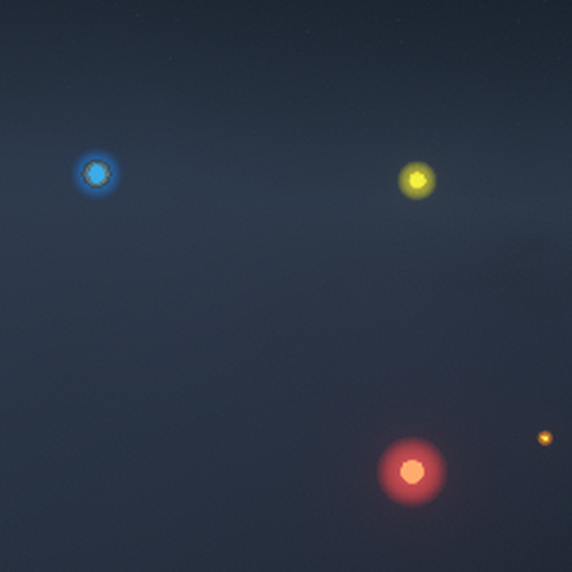

# 实现原理

这份文档记录「长虹陨落之歌」是怎么做出来的，重点是**为什么这么做**。
面向的是想给 Minecraft 26.1 写类似东西的人，以及以后回来改这个模组的自己。

- 目标版本：Minecraft 26.1.x / Fabric Loader 0.19.3 / Mojang 官方映射 / JDK 25
- 结论都来自真机实测（开着 Iris + Complementary 光影），推断出来的会标「推断」

---

## 1. 总体结构

```
src/main/java/com/sandwalls/longbow/        ← 服务端也加载的部分
  LongbowMod.java          注册物品/效果/网络包；每 tick 维护飞行、幻、水火不侵
  item/                    ArcfallLongbowItem（弓本体：蓄能、发射）
                           ArcfallBalladItem（「虹」）、LongbowItems（注册）、RainbowText（彩虹物品名）
  logic/                   ArcfallArrowData（箭的标记与追踪数据）、DestructionQueue（分帧破坏队列）
                           LockManager（服务端锁定表）、DashManager（疾行）、MiningModeManager（探矿）
  net/                     FxPayload（S2C 特效点）、FxBroadcaster；LockPayload / DashPayload / ProspectPayload（C2S）
  mixin/                   AbstractArrowMixin（追踪/摩擦/穿透/命中/末影人/尾迹）、PlayerMixin（光速挖掘）
  effect/                  PhantomEffect（幻）、ImmuneEffect（水火不侵）
  fx/                      LongbowParticles（注册 longbow:trail_orb）、TrailOrbOptions（粒子参数）
  test/                    LongbowSelfTest（/longbow selftest，34 项断言）

src/client/java/com/sandwalls/longbow/client/   ← 只在客户端加载
  LongbowClient            初始化、按键、左键锁定、无人值守测试
  ClientAim                64 格实体射线
  LockOnRenderer           白框的「目标查询」，不负责画
  ClientFxManager          所有世界空间特效的实际绘制 + 粒子撒点
  LongbowHud               蓄力条 / 档位 / 锁定提示
  particle/TrailOrbParticle  尾迹光球的粒子本体
```

两条原则贯穿全局：

- **服务端只决定「发生了什么」，客户端只决定「看起来怎样」。** 服务端从不发粒子给远距离玩家
  （原版 `ServerLevel.sendParticles` 只发 32 格内的），改为发语义包，客户端自己生成。
- **能用原版通道就不用自建通道。** 粒子走原版粒子系统，方块破坏走原版 `Level.setBlock`，
  只有"发光面片"这一件事找不到原版路径，才自己拼了一个渲染批次。

---

## 2. 蓄能与发射

`ArcfallLongbowItem` 用 `getUseDuration` + `onUseTick` 维护一个蓄能值 `charge`，
`releaseUsing` 只在 `heldTicks >= 1` 时算有效射击（不拿 charge 卡门槛，否则轻击档射不出去）。

| 常量 | 值 | 含义 |
|---|---|---|
| `LIGHT_TICKS` | 10（0.5 秒） | 轻击档上限 |
| `LIGHT_CHARGE` | 100 | 轻击档固定蓄能 |
| `NORMAL_TICKS` | 40（2 秒） | 从 100 涨到 10000 的时长 |
| `OVERLOAD_DELAY_TICKS` | 160（8 秒） | 平台期长度（2~10 秒停在 10000） |
| `OVERLOAD_TICKS` | 120（6 秒） | 从 10000 冲到 500000 的时长 |
| `MAX_NORMAL` / `MAX_OVERLOAD` | 10000 / 500000 | 蓄能上限 |

蓄能条把 10000 放在**正中间**：左半段线性 0→10000，右半段 10000→500000，这样不管在哪一档，
指针位置和"还差多久"都是直观的。

发射时的物理参数由 charge 插值：初速 4→8 格/tick，重力 0.005→0.05 格/tick²，
散布 `uncertainty = 0.0`（零散布）。速度上限在 mixin 里另夹了一道 12 格/tick，
防止超载档的箭一 tick 跨过几个区块、穿模穿掉命中判定。

---

## 3. 破坏：沿弹道方向的圆柱

命中瞬间取**箭当时的 `getDeltaMovement()` 方向**做圆柱中心轴，而不是简单的球：

```java
// 半径 / 长度按 charge 从 2/8 插到 32/128
// 常态满蓄 10000 恰好等于 8.489796 / 33.959184（和上一版 100000 的手感对齐）
```

一次性遍历几十万方块会直接卡死，所以拆成 `DestructionQueue`：每 tick 处理 6000 个方块，
先进先出，箭已经销毁了也照样把队列跑完。

几个不显然的细节：

- **击杀归属**：范围伤害用 `level.damageSources().source(DamageTypes.MAGIC, player)`，
  纯 `magic()` 不会给玩家记经验、也不算玩家的击杀。
- **自保**：清理时跳过发射者周围 3.2×3.2×4 的方块，秒杀列表里也排除本人——
  否则蓄力射一箭会把自己脚下的地炸没。
- **只炸一次**：命中方块时立刻销毁箭。不销毁的话，脚下那块方块被挖掉后箭会继续下落，
  在下一格再触发一次命中，看起来很像是"连续爆炸"的 bug。
- **末影人特判**：原版 `EnderMan.hurtServer` 对弹射物会尝试传送 64 次、成功就 `return`，
  箭的伤害根本不结算。这里改用 `playerAttack`（非投射物）伤害源，正常吃伤害也不会触发受击传送。

---

## 4. 锁定与追踪

客户端 `ClientAim` 做 64 格实体射线，每 tick 更新"准星指向谁"。
`LockOnRenderer` 只回答两个问题——`aimedBox()` / `lockedBox()`——不负责绘制
（原因见下一节：绘制必须走同一个面片批次）。

左键 → `ClientLock.lock(entity)` + `LockPayload(entityId)` 发给服务端 →
`LockManager` 记下 `实体 id → 玩家`。发射时把目标 id 写进箭的 tag，
`AbstractArrowMixin` 每 tick 把速度方向往目标掰 0.45：

```java
Vec3 want = target.position().add(0, target.getBbHeight() * 0.5, 0).subtract(arrow.position()).normalize();
arrow.setDeltaMovement(arrow.getDeltaMovement().scale(1 - 0.45).add(want.scale(0.45)).normalize()
    .scale(arrow.getDeltaMovement().length()));
```

注意速度**大小保持原样**，只改方向，所以追踪不会让箭越飞越快或越飞越慢。
锁定目标是 `Entity` 而不是 `LivingEntity`，末地水晶这类也能锁。

**穿透预算**：命中实体后按 charge 得到 0.48~24 格预算，命中后扣掉实际位移，
扣完立刻销毁；命中实体的同一 tick 自动解除追踪，否则箭会绕着尸体打转。

---

## 5. 客户端特效层

这一节是整个项目里最费劲的部分。

### 5.1 第一个坑：光影下什么都画不出来

最早按常规写法用 `Gizmos.cuboid` / `Gizmos.line` 画发光框，开光影后画面变成一坨发光的青蓝色乱块，
控制台刷：

```
Missing program minecraft:pipeline/debug_filled_box in override list. This is likely an Iris bug!!!
```

根因：Iris 的 `MixinShaderManager_Overrides#redirectIrisProgram` 拦截 `GlDevice#getOrCompilePipeline`，
只对 `IrisPipelines` 里那张白名单（60 余条 core shader）做替换。
`Gizmos` 走 `debug_filled_box` / `debug_lines`，`RenderPipelines.DEBUG_QUADS` /
`DEBUG_FILLED_BOX` / `DEBUG_POINTS` 也一样，**都不在白名单里**。
不在白名单时拿到的是原版程序，顶点属性映射和光影世界对不上，颜色和混合全错。

实测对比：`DEBUG_FORCE` 在正前方 3 格画一个 1 格大白面片，光影一开**彻底消失**——
不是画歪，是一个顶点都不提交。

白名单要在 `mods/iris-fabric-*.jar` 里翻 `net/irisshaders/iris/pipeline/IrisPipelines.class` 的
`<clinit>`，它注册 `coreShaderMap`。

### 5.2 结论：`LIGHTNING` 是唯一能用的"自由画四边形"管线

白名单里顶点格式为 `POSITION_COLOR + Mode.QUADS` 的只有 `RenderPipelines.LIGHTNING`，
混合函数 `BlendFunction.LIGHTNING` 是**加光混合**（`src*srcAlpha + dst`），正好适合发光。

```java
private static final RenderType FX_QUADS = RenderType.create(
    "longbow_fx_quads",
    RenderSetup.builder(RenderPipelines.LIGHTNING).createRenderSetup());
```

顺带两个注意点：

- 别用 `RenderTypes.debugQuads()`：它带 `sortOnUpload()`，顶点会进排序缓冲，
  在 `BEFORE_GIZMOS` 里显式 `endBatch` 刷不掉。
- 写完顶点**必须** `bufferSource.endBatch(renderType)`，否则顶点留在 builder 里，
  要等这一帧后面某个不确定的时机才顺带刷出去，表现就是"写了但看不见"。

### 5.3 坐标约定：写「世界坐标 − 相机坐标」

在 `LevelRenderEvents.BEFORE_GIZMOS` 这一刻，`poseStack` 是 `LevelRenderer` 里新建的**恒等**栈，
而着色器用的 `ModelViewMat` 只含相机旋转、不含平移。所以顶点必须自己减掉相机位置：

```java
Vec3 cam = context.levelState().cameraRenderState.pos;
// 顶点 = 世界坐标 - cam
```

朝向相机的基向量则由 `cameraRenderState.orientation` 旋转单位轴得到（x→右、y→上、-z→前）：

```java
Vector3f right = new Vector3f(1, 0, 0).rotate(orientation);
Vector3f up    = new Vector3f(0, 1, 0).rotate(orientation);
```

### 5.4 纯几何怎么拼出"好看"

`LIGHTNING` 只吃四边形、且开着背面剔除，所以所有形状都得用四边形拼：

- `quad(a,b,c,d)`：四个世界坐标点写一个四边形。
- `tri(a,b,c)`：退化四边形 `a,b,c,c` 当三角形用。
- `bladeFacing(center, u, n)`：把四边形摆成"面朝相机"的窄带。
  管线剔除背面，所以先算 `n × u` 与指向相机向量的点积，为负就把 `n` 翻过来，
  只发**一个**朝向相机的面，比正反各发一遍省一半顶点。
- `boxWire(aabb)`：12 条棱，每条棱用 `bladeFacing` 画一条带子。
- `needle(base, dir, perp, len, width)`：分 3 段、宽度和 alpha 一起收到 0 的渐细"针"，
  星芒的主刺和斜刺都是它。

**发光感从哪来**：没有 bloom 通道可用，靠"多层半透明叠加"逼近。
星芒 = 两层圆晕（内环亮、外环收到 0）+ 8 根渐细的针，中心自然最亮。

**屏幕尺寸恒定的技巧**：星芒的世界尺寸写成 `0.045 × 距离`，再夹到 `[0.18, 2.6]`。
世界尺寸除以距离就是屏幕尺寸，所以除完刚好是常数。拖尾棱粗则用另一种补偿
（见 §5.6），思路一样。



### 5.5 箭头星芒挂在哪儿：不要遍历实体

`level.entitiesForRendering()` 等于 `ClientLevel.getEntities().getAll()`，
**箭一旦被移除就查不到**，实测连续几十帧 `arrows=0`（箭落地就被移除了）。

改成让服务端在拖尾包里标一个"头"：`AbstractArrowMixin` 每 tick 沿位移补 10~28 个点，
把**最后一个点**（`i == fxCount`）的 `FxPayload.dx` 写成 `1.0` 当标志位。
客户端只认"最近 2 tick 且带 head 标记"的点，按 0.36 格聚类去重，每支箭每 tick 得到一个星芒。
误差不到 0.2 格，而且完全不依赖实体列表的可见性。

> `dx/dy/dz` 三个字段本来给方向留的，这里被借去当标志位了。以后要真的传方向，记得换字段。

### 5.6 拖尾：几何、寿命、随距离的粗细补偿

拖尾点由服务端沿位移补，间距锁 0.15 格（`min(28, max(10, ceil(delta/0.15)))`）。
客户端每个点画一个空心线框方块，寿命 900 tick = 45 秒，队列上限 20000 个。

棱粗有一个必须做的距离补偿：面片在世界里的厚度会随距离缩成亚像素，整条线会消失。

```java
double thick = Math.min(0.05, Math.max(half * 0.13, dist * 0.0011));
```

`half * 0.13` 是近距离的"按框边长比例"，`dist * 0.0011` 是"1 像素约等于这么厚"的保底，
两者取大。0.13 这个比例是调出来的：18% 近距离像实心板，7% 又太细。

### 5.7 彩色光球：自定义粒子这条通道是好用的

在踩了 §5.1 的坑之后，一度以为"自定义贴图在光影下没救"。其实要看走哪条通道：

| 通道 | 光影下能采到自定义贴图吗 |
|---|---|
| `RenderSetup.withTexture` + 自建管线 | **不能**。无报错但整片透明；换成原版方块贴图则显示成暗方块 |
| 原版粒子图集（`assets/<ns>/particles/*.json`） | **能**。这条链是原版自己的采集链，我们只是往图集里塞了张图 |

所以光球做成了自定义粒子 `longbow:trail_orb`，三件套缺一不可（少任何一环粒子会被**静默丢弃**，
日志里只有 `Missing particle sprites` 或者什么都没有）：

1. `LongbowParticles.initialize()` 注册 `ParticleType`（`FabricParticleTypes.complex`）
2. `assets/longbow/particles/trail_orb.json` 指定精灵集，贴图放
   `assets/longbow/textures/particle/orb_ball.png`
3. 客户端 `ParticleProviderRegistry.getInstance().register(TYPE, Provider::new)`

粒子本体继承 `SingleQuadParticle`，`Layer.TRANSLUCENT` 走
`TextureAtlas.LOCATION_PARTICLES` + `RenderPipelines.TRANSLUCENT_PARTICLE`（这两条都在 Iris 白名单里）。

还有三个不显然的约束：

- **尺寸是边长不是半径**。`getQuadSize()` 返回的是四边形**边长**（格）。原版经验球整颗约 0.3 格。
- **普通粒子有 32 格生成限制**。`ClientLevel.doAddParticle` 里
  `camera.position().distanceToSqr(x,y,z) > 1024.0` 就直接 return，不报错不打日志。
  跟箭跑远的特效必须用 `addParticle(options, overrideLimiter = true, ...)` 那个重载。
- **粒子图集默认邻近采样**。64×64 的贴图放到屏幕上 50px 以上，硬边会变成台阶。
  所以球的贴图边缘过渡留了很长（alpha 到 r≈1.0 才归零），也没做细亮边。

另外 `ParticleGroup` 每个渲染组有 **16384 个粒子的硬上限**（`EvictingQueue`，超了淘汰最旧的），
按"每 tick 最多撒 28 颗 × 15 秒寿命"算最坏也就 8000 多颗，没到顶。

去"塑料感"的过程也值得记一笔：`alpha 接近 1 + 明确高光 + 强球面明暗`三件一起就是塑料台球。
原版经验球的顶点色 alpha 只有 0.5，整体半透明才像"光"。最后是
**球心 alpha 0.88 × 粒子 0.80 = 合成约 0.70、没有高光点、边缘长柔边**。



### 5.8 出现与消失

球的生命曲线（`TrailOrbParticle`）：

| 阶段 | 曲线 |
|---|---|
| 淡入 | 前 0.8% 寿命（约 2.4 tick）alpha 0→0.80，几乎瞬现 |
| 长大 | 前 1.5%（约 4.5 tick）0.80→1.0 倍，只收个边 |
| 呼吸 | `×(1 + 0.10·sin(age·0.11 + 相位))`，相位每颗随机，避免同频闪 |
| 收尾 | 后 26% 尺寸 1.0→0.55，alpha smoothstep 到 0 |

最初淡入用了 12 tick、长大用了 30 tick，肉眼能看出"浮现"的感觉，砍掉后就干净了。

---

## 6. 网络包

只用了四个包，全部是 Fabric 的 `CustomPacketPayload`：

| 包 | 方向 | 用途 |
|---|---|---|
| `longbow:fx` | S2C | 一个特效点：`kind`（0 拖尾 / 1 爆发 / 2 施法）、坐标、`dx/dy/dz`、颜色、半径 |
| `longbow:lock` | C2S | 锁定哪个实体 id（-1 表示解除） |
| `longbow:dash` | C2S | 疾行档位 |
| `longbow:prospect` | C2S | 探矿开关 |

`longbow:fx` 是唯一高频的包（每 tick 10~28 个），所以字段塞得很紧：
`kind` 用 varint，坐标用 double，`dx` 兼职"是否箭头位置"的布尔标志。
广播只发给**离特效点 192 格内**、且在同一维度的玩家。

> 为什么不直接用 `ServerLevel.sendParticles`：那个 API 只发 32 格内的
> （`pos.closerToCenterThan(new Vec3(x,y,z), overrideLimiter ? 512.0 : 32.0)`，
> 不带 `overrideLimiter` 的重载默认 `false`），而且**不会报错不会打日志**。
> 箭经常飞出去几十格，用它做跟箭特效会莫名其妙断掉。

---

## 7. 调参速查表

改手感先看这张表，别乱翻文件。

| 想调什么 | 改哪里 | 现值 |
|---|---|---|
| 蓄能时间轴 | `ArcfallLongbowItem` 的 `*_TICKS` | 见 §2 |
| 破坏半径 / 长度 | 同上 `NORMAL_BLAST_*` | 8.489796 / 33.959184（满蓄 32 / 128） |
| 每 tick 破坏方块数 | `DestructionQueue` | 6000 |
| 追踪力度 | `AbstractArrowMixin` 的 0.45 | 0.45 |
| 穿透预算 | `ArcfallArrowData` | 0.48 → 24 |
| 疾行档位 | `DashManager.GEAR_MULTIPLIER` | {0, 4.0, 11.0} |
| 拖尾寿命 | `ClientFxManager.TRAIL_LIFE` | 900 tick（45 秒） |
| 拖尾棱粗 | `submitTrails` 的 `thick` | `min(0.05, max(half*0.13, dist*0.0011))` |
| 星芒大小 | `submitArrowHeads` 的 `half` | `clamp(dist*0.045, 0.18, 2.6)` |
| 星芒尖刺长度 | `star()` 里的 `half*2.0` / `half*0.95` | — |
| 光球密度 | `ClientFxManager.ORB_EVERY` / `ORB_PER_TICK` | 1（每点一颗）/ 28 |
| 光球个头 | `spawnOrb` 里的 `size` | `(0.16 + rnd*0.11) / 2` 格 |
| 光球撒布范围 | `ORB_SPREAD_NEAR/FAR/Y` | 0.70 / 3.80 / ±2.20 格 |
| 光球寿命 | `ORB_LIFE` / `ORB_LIFE_JITTER` | 300 / 90 tick |
| 光球透明度 | `TrailOrbParticle.BASE_ALPHA` | 0.80 |
| 光球贴图 | `tools/orb_texture.py` 生成 | `orb_v8` |

颜色统一由服务端按 tick 推进彩虹相位，客户端不再自己算色。

---

## 8. 排障钩子

只在 `-Dlongbow.autotest=1` 时被调用，正常游戏不会跑到：

| 钩子 | 作用 |
|---|---|
| `ClientFxManager.debugSeedTrail(n)` | 准星右侧摆一排彩虹拖尾点，并顺手撒球 |
| `debugSeedBox()` / `debugSeedFlare()` | 白框 / 固定位置星芒，验证管线通不通 |
| `debugSeedOrbPortrait()` | 前方 4/8/16 格摆三颗**等屏幕尺寸**的球，用来比贴图质感 |
| `debugLookAtLastTrail(client)` | 把镜头转向现有拖尾，截图才拍得到 |
| `FX_DEBUG` 日志 | 每 40 帧打 `frame / trails / orbs / 相机与 pose` |

无人值守跑法：启动参数加 `-Dlongbow.autotest=1` 和 `--quickPlaySingleplayer <存档>`，
模组会自动进世界 → 固定半夜晴天 → 跑 `/longbow selftest` → 在固定 tick 截图 → 退出。
